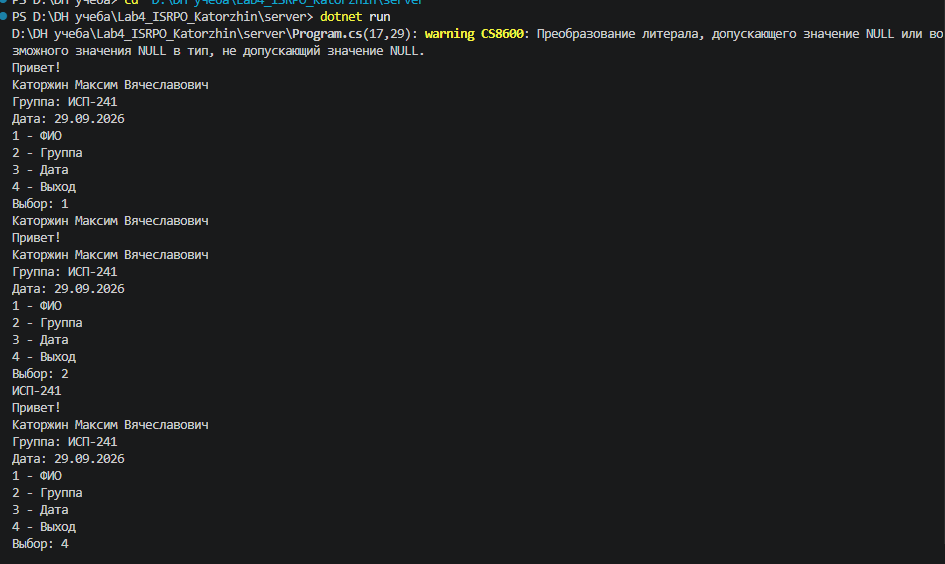
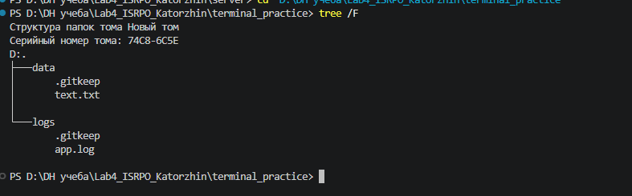
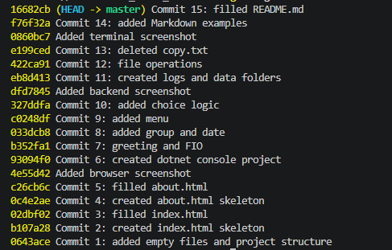

# Лабораторная работа №4

ФИО: Каторжин Максим Вячеславович  
Группа: ИСП-241  
Дата: 29.09.2026

## Описание
Проект для лабы 4. Git, Markdown, терминал.

## Содержание
- [Структура](#структура)
- [Markdown](#markdown)
- [LaTeX](#latex)

## Структура
- client/
  - index.html
  - about.html
- docs/
  - markdown_examples.md
- repo/
- server/
  - Program.cs
- terminal_practice/
- README.md

## Markdown
# Заголовок
- Список


```csharp
Console.WriteLine("Hi");
```

## LaTeX
$a^2 + b^2 = c^2$

$$
\sum_{i=1}^n i = \frac{n(n+1)}{2}
$$

## Ссылка
[GitHub](https://github.com)

## Скриншоты





## Заключение
Всё сделано.