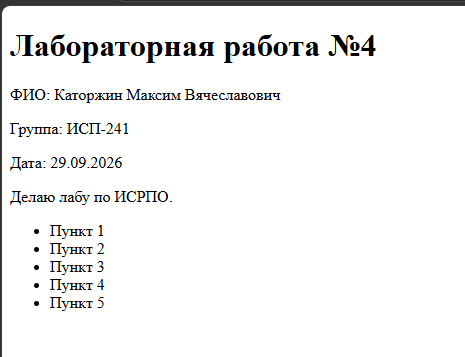

# H1
## H2
### H3
#### H4
##### H5
###### H6

---

**Жирный**
*Курсив*
~~Зачеркнутый~~
`моноширный`

- Маркированный
1. Нумерованный
   - Вложенный

> Цитата

```bash
git status
```

| A | B | C |
|:--|:-:|--:|
| 1 | 2 | 3 |



[GitHub](https://github.com)

[Внутренняя ссылка](#h1)

- [x] Сделано
- [ ] Не сделано

> [!NOTE]
> Пример

$a^2 + b^2 = c^2$

$$
\sum_{i=1}^n i = \frac{n(n+1)}{2}
$$